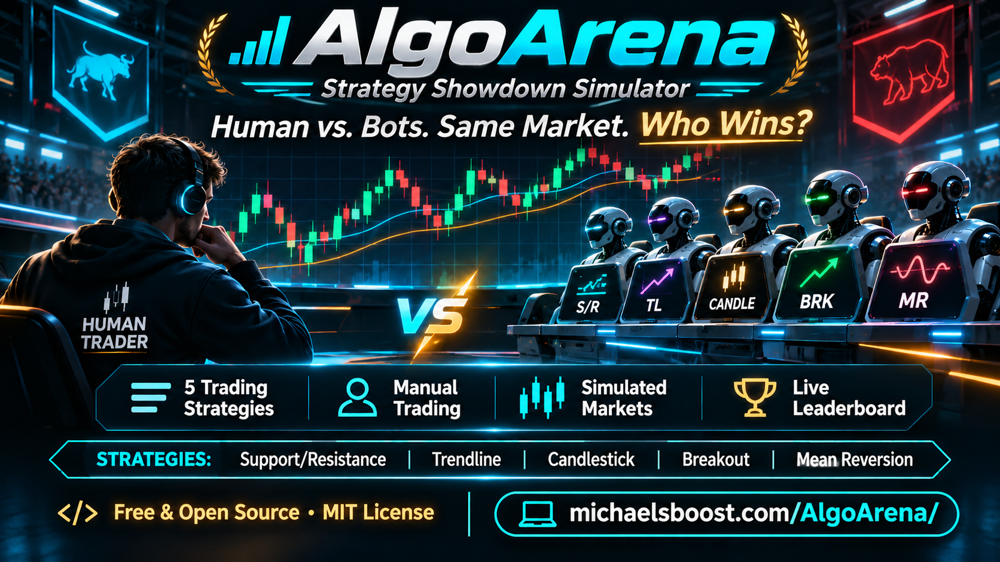

# ⚔️ AlgoArena — Strategy Showdown Simulator



## 🌟 Overview
**AlgoArena** is an experimental **trading battle simulator**.  

Load up simple trading methods—Support/Resistance, Trendline, Breakout, Mean Reversion, Candlestick patterns—and pit them **head-to-head on the same data**. Then throw yourself in the mix and see if your discretionary trading can outperform the bots.  

It’s not about perfect backtests or big data crunching—it’s about fun, learning, and quickly spotting which approaches hold up under pressure.  

> **🛠️ Built Using [kodeWeave](https://michaelsboost.github.io/kodeWeave/)**  
> Lightweight, fast, and designed for accessibility across devices. No build step required.

## 🚀 Launch the App
🌍 Try it live: [AlgoArena Simulator](https://michaelsboost.github.io/AlgoArena/)

No installs. No dependencies. Just open and play.

## 🛠️ Key Features  

### **👊 Strategy Showdown**
- Choose from built-in bots: S/R, Trendline, Candlestick, Breakout, Mean Reversion.
- Each bot follows its own rules—same data, same conditions.
- Watch them fight for the top of the leaderboard.

### **🧑 You vs. Them**
- Manual trading mode included—**you’re the final contender**.
- Place trades in real-time, drag SL/TP on the chart, or scale in/out.
- Hotkeys for fast action: **B = Buy, S = Sell, X = Close All**.

### **📊 Arena Dashboard**
- Live **Leaderboard** ranks bots + human by P&L.
- Track **win rates, trades, open PnL, total balances**.
- Performance breakdown: avg win/loss, efficiency, trades per hour.

### **📈 Real-Time Market**
- Simulated price feed with OHLC candles.
- Volatility, ATR, and trend filters influence bots.
- Market regime detection: **Trending / Ranging / Normal**.

### **⚙️ Risk & Rules**
- Prop-firm style constraints (daily loss stops, max lots, cooldowns).
- Margin checks & contract types (MNQ/NQ).
- ATR-based stops + partial take-profits built into bot logic.

## ⚡ Getting Started

### **1️⃣ Install & Run Locally**
```sh
# Clone the repository
git clone https://github.com/michaelsboost/AlgoArena.git
cd AlgoArena

# Open index.html in a browser
```

### **2️⃣ Dependencies**
- [Tailwind](https://tailwindcss.com/) • [PicoCSS](https://picocss.com/)  
- [AlpineJS](https://alpinejs.dev/)  
- Vanilla JS only—no build step required.

## 🧠 Contributing
AlgoArena is open to contributions!

- Fork the repo
- Create a new branch (`feature/add-candlestick-bot`)
- Submit a Pull Request  

Bug reports, ideas, and new strategies welcome. ⚔️

## 📜 License
Licensed under the MIT License — free to use, remix, and distribute.

Developed by: [Michael Schwartz](https://michaelsboost.com/)  
Maintained by: The open-source community

## ☕ Support This Project
If AlgoArena helps you, consider supporting:

- 🎨 Check out my Graphic Design Course: https://michaelsboost.com/graphicdesign  
- 🛒 Browse my store: https://michaelsboost.com/store  
- ☕ Buy me a coffee: http://ko-fi.com/michaelsboost  
- 👕 Grab a T-Shirt: https://michaelsboost.com/gear  
- 🖼️ Buy art prints: https://deviantart.com/michaelsboost/prints  
- 💰 Donate via PayPal: https://michaelsboost.com/donate  
- 💵 Donate via Cash App: https://cash.me/$michaelsboost  

Your support is greatly appreciated and helps fund this & future projects! 🚀
